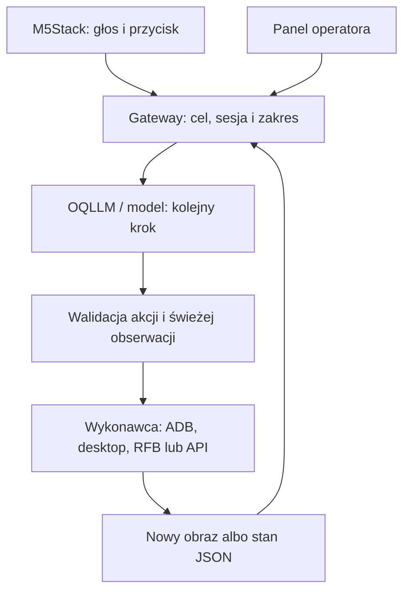
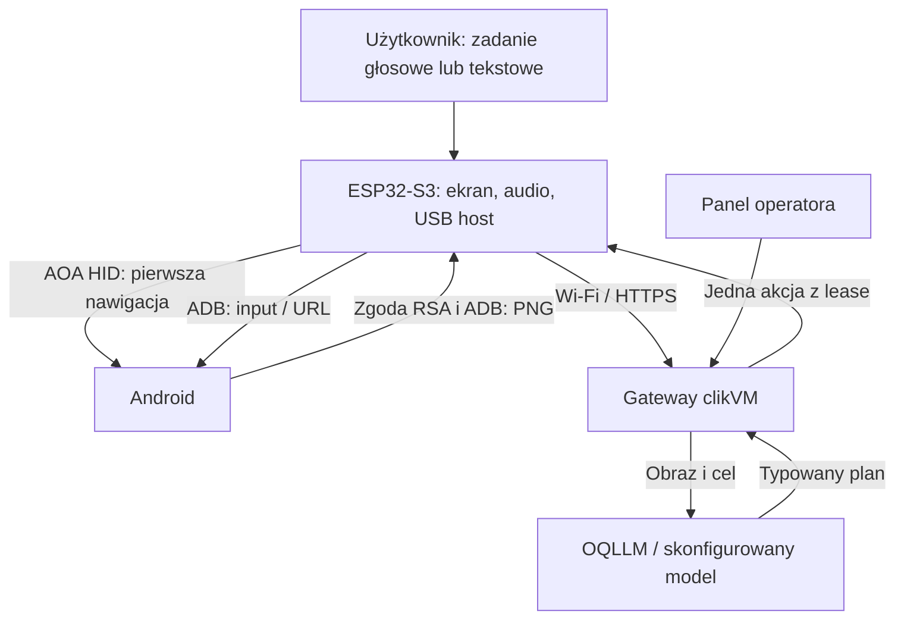

# clikVM / M5Stack — hey Asa dla telefonu, komputera i urządzeń API

**Wersja 0.2.0 — gateway, wykonawcy desktop/RFB/API, dziewięć profili firmware i dokumentacja; wydanie do kwalifikacji na sprzęcie.**

Kontroler ESP32-S3 zbiera zadanie głosowe, a hey Asa obserwuje urządzenie,
wykonuje dozwolony krok i sprawdza wynik. Kanał dostępu dobieramy do sprzętu:
ADB/AOA dla Androida, agent systemowy dla Windows/macOS/Linux X11, RFB/VNC
dla zgodnego serwera albo kontrakt HTTP API dla usługi sieciowej. Docelowe repozytorium:
[`clikVM/m5stack`](https://github.com/clikVM/m5stack).

Projekt zawiera rzeczywiste adaptery, panel operatora, lokalny panel KM,
kontroler głosowy z osobnym tokenem, testy protokołów i adopcję kontraktów
Wellmanifest. Obserwacja może być PNG albo stanem JSON. **Samo HID nie daje
obrazu i nie jest pełnym KVM.** Bez obserwacji gateway blokuje autonomiczny plan.

Na Androidzie ADB nie wymaga aplikacji z Google Play; właściciel włącza debugowanie
i zatwierdza RSA. Na komputerze obraz dostarcza agent lub istniejący serwer VNC.
Zakres nie obejmuje dowolnego zablokowanego urządzenia, portalu Wayland, iOS KVM
ani przechwytywania BIOS przez sam M5Stack.

Zacznij od [wyboru architektury](docs/universal-system.md),
[agenta desktopowego](docs/desktop-agent.md) i [trybów kontrolera](docs/controller-modes.md).
Ścieżka strony objaśniającej rozwiązanie: `heyasa/let-heyasa-com`, domena docelowa
`set.heyasa.com`; publikacja strony jest odrębna od wdrożenia prywatnego gatewaya.

## Stan wydania

| Element | Stan i dowód |
|---|---|
| Gateway, panel, autoryzacja, kolejka, zdarzenia i replay | Implementacja; testy w `tests/` |
| ESP-IDF 5.4.2, CoreS3 / LCD-1.54 / Touch-1.54 | Źródła i osobne profile; wynik kompilacji w raporcie walidacji |
| AOA HID i ADB RSA/shell-v2/screencap | Własny klient USB; testy parsera na komputerze, pełna kompilacja |
| Windows / macOS / Linux X11 | Agent `clikvm-node`: screenshot, klawiatura, mysz; realna sesja OS wymaga kwalifikacji |
| RFB/VNC 3.3/3.7/3.8 | Klient z ograniczonym framebufferem, autoryzacją i obsługą fragmentacji; testy prawdziwego TCP |
| HTTP API | Oddzielny stan JSON, stały origin, operacje ze schematami argumentów, brak dowolnego URL z modelu |
| M5Stack sieciowy / HID device | Osobne profile, scoped controller API oraz TinyUSB KM; brak automatycznego łączenia HID z obrazem innego adaptera |
| STT/TTS i model obrazu | Adaptery wymagające rzeczywistych endpointów i kluczy operatora |
| Wellmanifest | Kanoniczne schematy POA i Logs, hashchain, przypięte źródła i jawne luki Wellmana |
| Telefon, USB-C/VBUS, LCD i audio na płytce | **HIL NOT_RUN** — brak fizycznego sprzętu w środowisku przygotowania |
| Publikacja na GitHub | Lokalny projekt z ustawionym origin; push wymaga dostępu do repozytorium |

Szczegółowe dowody: [walidacja wydania](docs/validation.md),
[procedura HIL](docs/hardware-validation.md), [standardy](docs/standards.md).
Zielona kompilacja i symulator nie potwierdzają współpracy konkretnego telefonu
z konkretnym adapterem USB.

## Jak działa — wspólny cykl



Każda sesja deklaruje platformę, transport, rodzaj obserwacji, akcje i klawisze.
Token kontrolera ma stałe przypisanie do celu; nie daje uprawnień operatora.
Zmiana sesji w czasie nagrywania przerywa zlecenie zamiast wysłać je do nowego celu.
Po niepewnej akcji nie ma automatycznej powtórki kliknięcia.

### Android — zachowana ścieżka USB host



ESP32 pozostaje hostem USB zarówno przy AOA HID, jak i przy ADB. AOA wysyła
raporty klawiatury/myszy przez protokół akcesorium Androida; nie jest tu
przełączaniem ESP32 w zwykłą klawiaturę USB device. Bez ADB nie ma obrazu
telefonu. Po uzyskaniu ADB kamera nie jest potrzebna do zwykłego zrzutu ekranu.
Podstawy protokołów: [AOA 2.0](https://source.android.com/docs/core/interaction/accessories/aoa2)
i [Android Debug Bridge](https://developer.android.com/tools/adb).

## Uruchomienie na komputerze — kilka poleceń

Wymagane: Python 3.11+; do testów natywnych GCC lub Clang; Node.js do testu
kontraktu panelu. Polecenia wykonuj z katalogu projektu, w Linux/macOS/WSL.

```sh
make setup
make init-demo
make serve
```

W drugim terminalu:

```sh
make simulate
```

Otwórz `http://127.0.0.1:8787/`. Token operatora znajdziesz w lokalnym `.env`,
w polu `CLIK_OPERATOR_TOKEN`. Generator tworzy losowe tokeny, nie wypisuje
sekretów i nie nadpisuje istniejącego `.env`. Panel przechowuje token tylko
w pamięci karty. Symulator jest wyraźnie oznaczony i używa syntetycznego obrazu;
nie udaje połączenia z telefonem ani odpowiedzi prawdziwego modelu.

`make init-demo` jest jednorazowe. Jeśli masz już `.env`, dopasuj
`CLIK_ALLOW_SIMULATION=1` ręcznie do demonstracji. Dla fizycznego wdrożenia
użyj `make init` i pozostaw `CLIK_ALLOW_SIMULATION=0`.

Bez Makefile:

```sh
python3 -m venv .venv
.venv/bin/pip install -e '.[dev]'
.venv/bin/clikvm init-env --device cores3-01 --simulation
.venv/bin/clikvm --env-file .env serve --host 127.0.0.1 --port 8787
```

## Komputer i kontroler głosowy

Na nowym wdrożeniu gatewaya utwórz osobne tożsamości:

```sh
.venv/bin/clikvm init-env --device office-pc --controller m5-01
```

Nie uruchamiaj generatora ponownie nad istniejącym `.env`. Dla kolejnego stanowiska
dopisz odrębny token urządzenia do `CLIK_DEVICE_TOKENS_JSON`, kontrolera do
`CLIK_CONTROLLER_TOKENS_JSON` oraz powiązanie do `CLIK_CONTROLLER_TARGETS_JSON`.
Nie kopiuj tokena operatora do firmware ani agenta.

Na kontrolowanym komputerze z Python 3.11+, z katalogu tego projektu:

```sh
python3 -m venv .venv-node
.venv-node/bin/python -m pip install -e 'agents/desktop[native,rfb]'
cp agents/desktop/examples/native.json node.json
cp agents/desktop/examples/node.env.example node.env
chmod 600 node.env
```

Ustaw `gateway_url` i `device_id` w `node.json`, a przypisany temu urządzeniu
token w `node.env` jako `CLIK_NODE_TOKEN`. Następnie:

```sh
.venv-node/bin/clikvm-node --config node.json --env-file node.env doctor
.venv-node/bin/clikvm-node --config node.json --env-file node.env run
```

`doctor` faktycznie odczytuje ekran/stan; nie klika. Na Windows użyj
`.venv-node\Scripts\clikvm-node.exe` i poleceń PowerShell z
[instrukcji agenta](docs/desktop-agent.md). macOS wymaga Screen Recording
i Accessibility; Linux bezpośrednio obsługuje X11. RFB oraz HTTP API mają
osobne przykłady w `agents/desktop/examples/` i nie wymagają biblioteki native.

M5Stack wgraj profilem `cores3-network` (lub właściwym `lcd154*-network`).
W panelu konfiguracji wpisz ID `m5-01` i **token kontrolera**. Głos, capture,
cancel i TTS kierowane są do przypisanego `office-pc` przez gateway. Dostęp do
serwera z Wi-Fi wymaga wdrożonego HTTPS; `127.0.0.1` wskazuje lokalny komputer.

## Pierwsze uruchomienie kontrolera Androida

1. Wybierz rzeczywisty model: **M5Stack CoreS3 K128**, Waveshare
   **ESP32-S3-LCD-1.54 SKU 33867** albo **Touch SKU 33869**.
2. Przygotuj ESP-IDF **v5.4.2**, wykonaj jego `install.sh esp32s3` i załaduj
   `export.sh`. Przypięte zależności komponentów są w `firmware/dependencies.lock`.
3. Zbuduj profil i wgraj go przez komputer:

   ```sh
   bash scripts/firmware.sh cores3 build
   bash scripts/firmware.sh cores3 -p /dev/ttyACM0 flash
   ```

4. Na LCD odczytaj nazwę AP, hasło WPA2 i kod panelu. Połącz się z AP i otwórz
   `http://192.168.4.1/`. Wpisz Wi-Fi, HTTPS URL wdrożonego gatewaya,
   identyfikator urządzenia oraz jego token z `CLIK_DEVICE_TOKENS_JSON`.
5. Przygotuj właściwy tor VBUS/CC opisany w [hardware.md](docs/hardware.md),
   odłącz komputer i podłącz telefon. Fizyczne krótkie dotknięcie/przycisk
   uruchamia hosta. Sam zwykły kabel C–C nie gwarantuje właściwych ról USB.
6. Użyj panelu KM do pierwszej nawigacji, jeśli telefon wspiera AOA HID.
   Właściciel włącza debugowanie USB i zatwierdza RSA na telefonie.
7. Po `ADB READY` pojawia się sesja i screenshot w panelu gatewaya. Krótkie
   naciśnięcie na kontrolerze nagrywa zadanie przez domyślnie 8 sekund.

Pełna instrukcja: [getting-started.md](docs/getting-started.md).
Core2, ESP32-C6 oraz nieokreślony „Core3” nie są profilami tej aplikacji.

## Integracja z OQLLM

Firmware łączy się **bezpośrednio po Wi-Fi z gatewayem**, który można uruchomić
obok OQLLM na tym samym serwerze i domenie. Laptop nie jest potrzebny w tym torze
po zakończeniu programowania. Model i klucze dostawców pozostają na serwerze.

Ustaw w `.env` pełny URL modelu obrazu, nazwę modelu i jego klucz:

```dotenv
CLIK_MODEL_ENDPOINT='https://TWOJ_SERWER/v1/chat/completions'
CLIK_MODEL_NAME='TWOJ_MODEL_Z_OBSLUGA_OBRAZU'
CLIK_MODEL_API_KEY='TWOJ_KLUCZ_SERWEROWY'
```

To przykład konfiguracji, nie obietnica istnienia takiego endpointu pod
`api.oqllm.com`. Zweryfikowany publiczny kontrakt OQLLM nie opisywał potrzebnej
transmisji screena, STT i TTS. Repozytorium `oqllm/oqllm` było niedostępne bez
uwierzytelnienia. Dlatego dostarczamy jawny adapter HTTP oraz oddzielny klient
istniejącego POA, bez deklarowania niezweryfikowanej integracji produkcyjnej.

Audio konfiguruje się przez `CLIK_STT_*` i `CLIK_TTS_*`; wszystkie pola opisują
[gateway/README.md](gateway/README.md) i [.env.example](.env.example).
STT przyjmuje WAV, TTS jest normalizowany do PCM16 mono 16 kHz.
Odtwarzanie w firmware wymaga włączenia `CONFIG_CLIK_TTS_ENABLED`.

## Standardy i kontrole

```sh
make test
make standards
```

- `.governance/manifest.json`: rejestracja profilu `runtime-service`.
- `.governance/poa-operations.json`: 15 rekordów — osiem uniwersalnych akcji i siedem zgodnych URI Androida.
- `.governance/poa.json`: proces obserwacja–akcja–weryfikacja.
- `.governance/poa-multidevice.json`: proces dla ekranów i stanów JSON.
- `.governance/standards.lock.json`: przypięte rewizje i hashe źródeł.
- `gateway/clikvm/audit.py`: rzeczywiste koperty Logs, kolejność i hashchain.
- SQLite: transakcyjne zdarzenia, pięć odtwarzalnych projekcji, idempotencja.

`wellman check` ma własny, uczciwie zachowany raport. Rozbieżność checkera POA
oraz wymuszony upstream profil LLM Subactor/MCP nie są maskowane dodatkowymi
polami ani fikcyjnymi usługami. Lokalna walidacja schematów **nie jest certyfikatem
pełnej zgodności floty Wellman**. Szczegóły: [standards.md](docs/standards.md).

## Organizacja kodu

| Katalog | Odpowiedzialność |
|---|---|
| `firmware/main` | Start, konfiguracja Wi-Fi, panel lokalny, pętla zadania |
| `firmware/components/clik_board` | LCD, dotyk/BOOT, audio i zasilanie |
| `firmware/components/clik_usb` | USB host, AOA HID, ADB i klucz RSA w NVS |
| `firmware/components/clik_hid` | USB device: klawiatura, mysz, watchdog zwolnienia i VBUS |
| `firmware/components/clik_protocol` | Parsery i ograniczone komendy, testowalne na komputerze |
| `firmware/components/clik_cloud` | HTTPS, sesja, streaming PNG, akcje i audio |
| `gateway/clikvm` | API, planner, adaptery upstream, SQLite, audyt, panel |
| `agents/desktop/clikvm_node` | Native, RFB, HTTP API, sesja, dzierżawy i dziennik wykonania |
| `tests` | Testy API, HTTP, panelu i natywnego protokołu |
| `.governance` | Adopcja Wellmanifest i przypięte kontrakty |
| `docs` | Architektura, sprzęt, wdrożenie, walidacja i decyzje |

## Wdrożenie i rozwój

`Dockerfile` i `compose.yaml` uruchamiają pojedynczy proces gatewaya ze stałym
wolumenem. Przykład Caddy zapewnia zakończenie TLS. Nie uruchamiaj kilku workerów
na tym samym katalogu SQLite; blokada właściciela stanu tego zabrania.
Backup obejmuje bazę oraz zachowane obrazy, a nie tylko eksport JSONL.
Instrukcja: [deployment.md](docs/deployment.md).

Wersja 0.2.0 nie zawiera automatycznej instalacji dowolnego programu na Androidzie,
obejścia ekranów zaufania, przechwytywania chronionych ekranów, zdalnego ADB po Wi-Fi,
strumienia wideo ani sterownika kamery. Obsługuje pojedynczy telefon na kontroler.
Pełen zakres: [limitations.md](docs/limitations.md).

Licencja kodu projektu: [Apache-2.0](LICENSE). Źródła komponentów i atrybucje:
[NOTICE](NOTICE). Zasady zmian i weryfikacji: [AGENTS.md](AGENTS.md).
