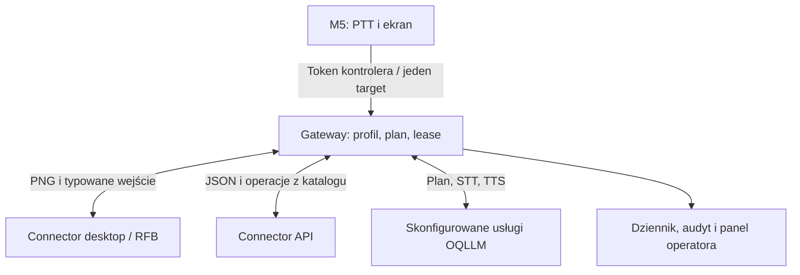
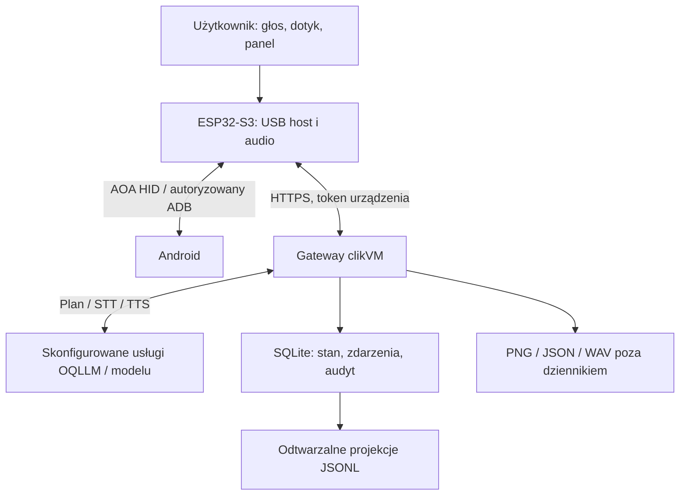
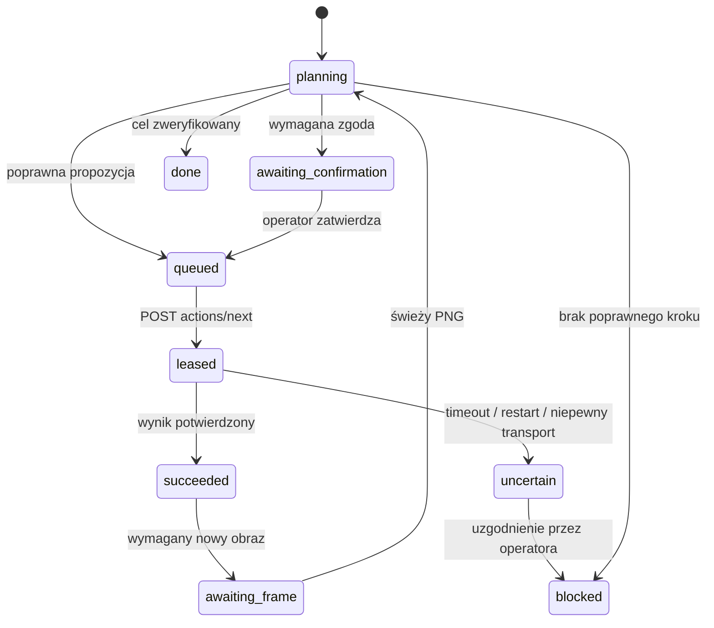

---
{
  "schema": "wellmanifest.docs/document/v1",
  "id": "clikvm-architecture",
  "kind": "information",
  "version": 1,
  "title": "Architektura kontrolera i usługi clikVM",
  "status": "draft",
  "owner": "clikVM/m5stack",
  "scope": "repository",
  "created": "2026-11-21",
  "updated": "2026-11-21",
  "review_after": "2026-12-21",
  "evidence": ["gateway/clikvm/app.py", "gateway/clikvm/store.py", "firmware/main/main.c", ".governance/poa.json"]
}
---

# Architektura

Kontroler **ESP32-S3 sam wykonuje AOA HID i klienta ADB**. Łączy się przez Wi-Fi
i HTTPS z usługą `gateway/` z tego repozytorium. Gateway zarządza sesją,
przechowuje obrazy, waliduje propozycje modelu i rozlicza wykonane kroki.
Może być wdrożony obok OQLLM na tym samym serwerze. Komputer ani Raspberry Pi
nie są wymagane jako pośredni host USB podczas działania.

Ścieżki `/v1/devices/...` i `/v1/sessions/...` to **API naszej usługi clikVM**.
Nie są stwierdzeniem, że takie endpointy istnieją na `api.oqllm.com`.
Publiczny adapter routingu OQLLM i skonfigurowane usługi modeli/STT/TTS opisuje
osobno `gateway/clikvm/upstream.py`; ich URL i możliwości muszą odpowiadać
rzeczywistemu wdrożeniu. Dostawca routingu nie staje się przez to automatycznie
modelem rozumiejącym obrazy ani usługą mowy.

## Sterowanie wieloma platformami w 0.2.0

Powyższy bezpośredni tor USB pozostaje profilem Androida. M5Stack może także
pracować jako zdalny interfejs głosowy do przypisanego targetu. W takim trybie
mikrofon i ekran pozostają na płytce, a obraz/stany i akcje obsługuje
`agents/desktop/clikvm_node`: lokalny pulpit Windows/macOS/Linux X11, klient
RFB/VNC albo lokalnie skonfigurowane API. Gateway stosuje tę samą transakcyjną
pętlę dzierżawy i ponownej obserwacji.



To nie wymaga USB pomiędzy M5 i PC: komunikacja jest przez HTTPS/Wi-Fi.
Token kontrolera nie jest tokenem operatora ani tokenem connectora.
Przypisanie `controller_id → target device_id` znajduje się w konfiguracji
serwera. Firmware wiąże polecenie z `expected_session_id`; zmiana sesji
podczas nagrywania/STT zatrzymuje stare żądanie. Każdy nowy cel kontrolera
wymusza świeżą obserwację.

Profil targetu jest stały dla sesji i określa platformę, transport,
`action_types`, klawisze, rodzaj obserwacji i opcjonalny katalog API. Brak
profilu oznacza kompatybilny Android z 0.1.0. Pixel input wymaga rzeczywistego
PNG. API-only dostarcza JSON i wyłącznie `api`/`wait`; panel nie pokazuje
wtedy wymyślonego ekranu. Sam HID to KM bez kanału obrazu — gateway odmawia
planowania autonomicznego celu. Wbudowany adapter Wayland portal, RDP ani
pełny iOS/iPadOS KVM nie jest dostarczany w tym wydaniu.

Dla API adres, metoda, ścieżka i referencje do sekretów pozostają na
connectorze. Model widzi ID/opis/schemat argumentów. Gateway i connector
niezależnie sprawdzają te argumenty; nie pozwalają im zmieniać URL ani
uruchamiać dowolnej powłoki. Niepewna mutacja API nie jest automatycznie
powtarzana. Stan JSON podlega tej samej kontroli świeżości, retencji,
idempotencji i odtwarzaniu jak PNG.

Dokładny kontrakt i status możliwości:
[UNIVERSAL.md](../gateway/docs/UNIVERSAL.md),
[CONTROLLERS.md](../gateway/docs/CONTROLLERS.md),
[compatibility.json](../gateway/docs/compatibility.json).
Oznaczenie adaptera jako zaimplementowanego nie zastępuje HIL konkretnego
stanowiska; wszystkie ścieżki sprzętowe pozostają `NOT_RUN`.

## Podział odpowiedzialności



| Komponent | Odpowiedzialność | Granica |
|---|---|---|
| `clik_board` | LCD, dotyk/BOOT, I²S, źródło VBUS CoreS3 | Nie potwierdza poprawności kabla ani elektryki hosta |
| `clik_usb` | Jeden właściciel USB, AOA, ADB AUTH RSA, screenshot i ograniczone polecenia | Nie klika zgody RSA; nie wystawia dowolnej powłoki |
| `clik_protocol` | Parser ADB, deskryptory HID, walidacja i cytowanie poleceń | Brak instalatora APK, dowolnego shell/exec i Unicode IME |
| `clik_cloud` | Uwierzytelniony HTTPS, obrazy, odbiór dzierżawy, wynik, audio | Model nie rozmawia bezpośrednio z USB |
| `main` / `provision` | Fizyczny Start, NVS, WPA2 setup, lokalne KM, kolejka użytkownika | Uruchomienie hosta wymaga fizycznego działania |
| `gateway` | Autoryzacja urządzenia/operatora, transakcje, polityka, planowanie | Odpowiedź modelu jest propozycją, nie uprawnieniem wykonania |

## Od połączenia do wykonywania zadania

### 1. Konfiguracja i zgoda telefonu

Firmware uruchamia ekran i sieć przy wyłączonym wyjściu hosta CoreS3.
Brak zapisanej konfiguracji lub nieudane połączenie Wi-Fi prowadzi do WPA2 AP
z losowym hasłem pokazanym na ekranie i lokalnego HTTP `192.168.4.1`.
Konfiguracja Wi-Fi, URL gatewaya, `device_id` i `device_token` jest zapisywana
w NVS. Dla ADB oddzielna przestrzeń `clik_adb` przechowuje indywidualny
RSA-2048; utrata konfiguracji Wi-Fi nie wymienia tego klucza.

Po odłączeniu komputera i przygotowaniu toru USB użytkownik uruchamia host
fizycznym przyciskiem/dotykiem. AOA `GET_PROTOCOL` → rejestracja HID → raporty
klawiatury/myszy pozwalają ręcznie poruszać się po interfejsie telefonu.
Nie ma `ACCESSORY_START`, automatycznej instalacji aplikacji ani omijania
uwierzytelnienia Androida. Debugowanie USB oraz zaufanie dla klucza potwierdza
użytkownik. Zgodność AOA konkretnego telefonu wymaga sprawdzenia.

Po wykryciu interfejsu ADB `ff/42/01` komponent negocjuje połączenie i obsługuje
challenge AUTH. Podłączenie innego telefonu lub ponowna enumeracja zmienia
`connection_generation`; aplikacja porzuca poprzednią sesję i stare kroki.
Szczegóły protokołu i źródła: [USB README](../firmware/components/clik_usb/README.md).

### 2. Obserwacja i propozycja

Firmware zakłada sesję na gatewayu i przesyła PNG z `exec:screencap -p`.
USB przekazuje porcje danych do HTTP bez przechowywania całego obrazu w RAM
ESP32. Gateway sprawdza sygnaturę, granice chunków, CRC, IHDR/IEND i limit
rozmiaru. Nie wykonuje pełnego dekodowania rastra w walidatorze kontenera.

Polecenie głosowe jest nagrywane lokalnie; po STT kontroler wykonuje aktualny
screenshot i przesyła tekst celu wraz z identyfikatorem obrazu. Również
polecenie tekstowe z lokalnego panelu najpierw pobiera nowy obraz.
Gateway planuje asynchronicznie, wykorzystując cel, rozmiar/obraz ekranu
i ograniczoną historię ostatnich kroków.

Wyjście modelu musi przejść ścisły schemat Pydantic z zabronionymi polami
nadmiarowymi. Dla profilu Androida dostępnych jest siedem operacji: `tap`, `swipe`, `key`, `text`,
`open_url`, `screenshot`, `wait`. Współrzędne są sprawdzane względem
rzeczywistego PNG. Tekst do Android `input text` to drukowalne ASCII bez `%`;
tekst celu/STT może być po polsku. URL jest zwykłym HTTP(S), bez danych
logowania w adresie. Model nie może zwrócić dowolnego polecenia ADB/shell.

### 3. Dzierżawa, wykonanie i ponowna obserwacja



Powyższy diagram łączy stan akcji i stan zamiaru; w bazie są to osobne rekordy.
`done` jest oceną planera na podstawie świeżej obserwacji, nie gwarancją
niezależnego audytora. `requires_confirmation` może wynikać z planu lub
globalnego `CLIK_REQUIRE_ACTION_CONFIRMATION`; zgoda Androida na ADB to jeszcze
inna granica i zawsze pozostaje po stronie telefonu.

Pobranie akcji jest **POST**, ponieważ tworzy jednorazową dzierżawę.
Odpowiedź wiąże `session_id`, `action_id`, `lease_id`, `based_on_frame`
i `valid_for_ms`. Firmware sprawdza aktualny obraz, generację USB i czas
dzierżawy. Dla akcji wejścia sukces wymaga statusu wyjścia 0 z ADB shell-v2.
Sukces powłoki oznacza przyjęcie polecenia; dopiero kolejny obraz pozwala
ocenić, czy interfejs rzeczywiście osiągnął oczekiwany stan.

Po wysłaniu wejścia nie wolno powtarzać go tylko dlatego, że zginęła odpowiedź
HTTP. Firmware zachowuje wynik w pamięci i ponawia ten sam idempotentny POST
wyniku. Gateway przechowuje odpowiedź pod kluczem żądania. Niepewna dzierżawa
po restarcie lub timeoutcie przechodzi do `uncertain`; operator porównuje
świeży obraz i jawnie uzgadnia wynik. W tej ścieżce nie ma automatycznego
ponowienia kliknięcia. Restart samego ESP32 traci wynik z RAM, więc nowa sesja
nie oznacza, że poprzedni efekt został cofnięty.

Terminalny konflikt wyniku 409 kończy ponawianie tego POST i pozwala wykonać
nowy obraz do uzgodnienia. Wygaśnięcie sesji jest sygnalizowane osobnym kodem
w nagłówku i powoduje utworzenie nowej, bez automatycznego ponowienia celu.
Pause zatrzymuje następne wejście, lecz nadal pozwala wysłać wynik kroku,
który dotarł już do telefonu. Opcjonalny TTS odzywa się raz po `done`, poza
otwartą dzierżawą akcji. Przy obliczaniu czasu pozostałego firmware odlicza
także RTT żądania wydającego lease.

## CQRS, dziennik zdarzeń i audyt

**CQRS jest podziałem semantycznym w jednej usłudze i jednej bazie SQLite**:
GET status/lista/PNG odczytuje stan, a POST zamiar/obraz/lease/wynik/zgoda
zmienia stan. Nie używamy osobnego brokera ani bazy wyłącznie do odczytu.
Model i sieć nie są wywoływane wewnątrz długotrwałej transakcji SQLite.

`Store.transaction()` używa `BEGIN IMMEDIATE`, WAL i blokady procesu.
Obsługiwana mutacja atomowo zapisuje tabele domenowe, wynik idempotencji
oraz rekordy `domain_events` zawierające kanoniczny `audit_json`. Triggery SQL
przechwytują insert/update/delete pięciu tabel projekcji: `sessions`, `frames`,
`intents`, `actions`, `idempotency`. Przed COMMIT pełny stan zmienionego wiersza
staje się zdarzeniem `projection_changed`, obok zdarzeń opisujących znaczenie
czynności. Typy REAL są zapisywane w tym zdarzeniu jako tekst dziesiętny
z zachowaniem precyzji; audyt upstream nie dopuszcza liczb zmiennoprzecinkowych.
W razie błędu
budowy audytu transakcja jest wycofana przed ogłoszeniem sukcesu. Tabela
zdarzeń jest przez aplikację dopisywana; bazą prawdy dla potwierdzonego stanu
pozostaje trwała baza, a nie plik wypisywany po odpowiedzi HTTP.

Po COMMIT eksportowane są dwie projekcje:

| Projekcja | Zawartość | Zachowanie przy błędzie eksportu |
|---|---|---|
| `logs/domain-events.jsonl` | Prywatne zdarzenia domenowe i pełne wiersze projekcji, w tym tekst celu oraz polecenia | Potwierdzone rekordy pozostają w SQLite |
| `logs/wellmanifest-events.jsonl` | Wersjonowany kanoniczny event Wellmanifest z hashem i poprzednikiem | `/health` wskazuje `event_export: deferred`; kolejny eksport odtwarza brakujące linie |

Eksporter używa blokady plikowej, odrzuca urwaną końcową linię i kontynuuje
od ostatniej zapisanej sekwencji. Tabela zdarzeń ma dodatkowe triggery
blokujące UPDATE i DELETE wykonywane zwykłym połączeniem aplikacji.

**Odtwarzanie stanu jest zaimplementowane** przez `Store.rebuild()` oraz CLI:

```sh
clikvm --env-file .env rebuild-projections --destination .state/rebuilt
```

Przed operacją zatrzymaj gateway; blokada właściciela bazy odrzuca równoległy
drugi proces. Komenda odczytuje zatwierdzone zdarzenia z oryginalnej SQLite,
odtwarza pięć tabel w **nowym, nieistniejącym wcześniej katalogu**, kopiuje
zachowane PNG i eksportuje JSONL. Nie nadpisuje oryginału. Test porównuje
wartości wszystkich pięciu projekcji. Zmiana schematu wiersza wymaga jawnej
migracji; narzędzie nie zgaduje konwersji.

Zakres odzyskiwania ma granice: cache ponowień TTS jest przejściowy i nie
podlega replay, a usunięte zgodnie z retencją media nie powstają z hashy.
Eksport samego publicznie bezpieczniejszego audytu nie wystarcza do odbudowy
stanu. Bieżące CLI korzysta z tabeli zdarzeń w SQLite, nie importuje pliku
JSONL jako niezależnego backupu. Prywatny dziennik domenowy zawiera cele
i teksty operacji; wymaga takich samych ograniczeń dostępu i polityki
przechowywania jak baza, mimo że oddzielny audyt pomija te treści.

Każdy event audytu ma rosnące `sequence`, `previousHash`, `eventHash`,
`inputHash`, czas RFC3339 i identyfikator podmiotu. `eventHash` oblicza się
z kanonicznego JSON bez tego pola. Binarne media, tokeny, transkrypcja i pełny
tekst celu nie trafiają do audytu. Łańcuch hashy wykrywa zmianę względem
zaufanego punktu odniesienia; sam w sobie nie zastępuje podpisu, zewnętrznego
zakotwiczenia ani kontroli dostępu do całej bazy.

## URL, URI, URN i czas

| Rodzaj | Przykład / implementacja | Znaczenie |
|---|---|---|
| URL transportu | skonfigurowany HTTPS gateway + `/v1/sessions/{id}/frames` | Miejsce wywołania; nie identyfikator niezmiennego obrazu |
| URI operacji | `proc://clikvm/android/tap/v1` | Wersjonowana nazwa lokalnego kontraktu operacji; nie adres sieciowy |
| URI procesu POA | `poa://clikvm/process/android-observe-act/v1` | Deklaracja procesu observe–plan–execute–verify w `.governance/poa.json` |
| URN screenshotu | `urn:clikvm:frame:sha256:{sha256}` | Tożsamość zawartości PNG; nie ujawnia miejsca pobrania |
| URN sesji w audycie | `urn:clikvm:session:{session_id}` | Podmiot zdarzenia, powiązany z uprawnieniami urządzenia |
| Czas faktyczny | `occurredAt` RFC3339 UTC + monotoniczny czas dzierżawy po stronie ESP32 | Kolejność audytu wspiera `sequence`; zegar sieciowy nie jest tokenem zgody |
| URT | Obecnie brak generowania URTLog | Nie zastępujemy URT własnym formatem udającym implementację pakietu |

Nazwy `proc://clikvm/...` i `urn:clikvm:...` należą do tego projektu.
Ich obecność nie oznacza publikacji w zewnętrznym rejestrze. Katalog operacji
jest generowany z rzeczywistych modeli, z hashem źródła; offline checker
odrzuca katalog nieaktualny względem kodu.

Dokładny zakres adopcji i niezgodności między kanonicznym POA a bieżącym
checkerem Wellman opisuje [standards.md](standards.md). Nie deklarujemy
pełnej certyfikacji profilu, zewnętrznej authority lifecycle ani obsługi URTLog
przy niezweryfikowanym publicznym API pakietu.

## Granice działania

Obserwacja jest klatkowa, po krokach, a nie strumieniem wideo KVM. Brak ADB,
ekran zabezpieczony przed przechwyceniem, zablokowany telefon lub niezgodność
AOA mogą uniemożliwić dany etap. Nie ma obietnicy działania na każdym Androidzie.
Lokalny panel konfiguracji używa HTTP w zaufanej sieci/AP; komunikacja
urządzenia z gatewayem domyślnie wymaga HTTPS i weryfikacji CA.

Ekran telefonu i treść strony są wejściem do modelu, nie źródłem uprawnień.
Propozycja nadal przechodzi schemat, aktualność obrazu, limity i politykę
zgody. Rozmowy, wysyłanie SMS i instalowanie programów nie mają osobnego,
automatycznego API w tym wydaniu. Wymagają poprawnej nawigacji po interfejsie
i takiej samej kontroli dzierżawy oraz zgód jak inne skutki na telefonie.
