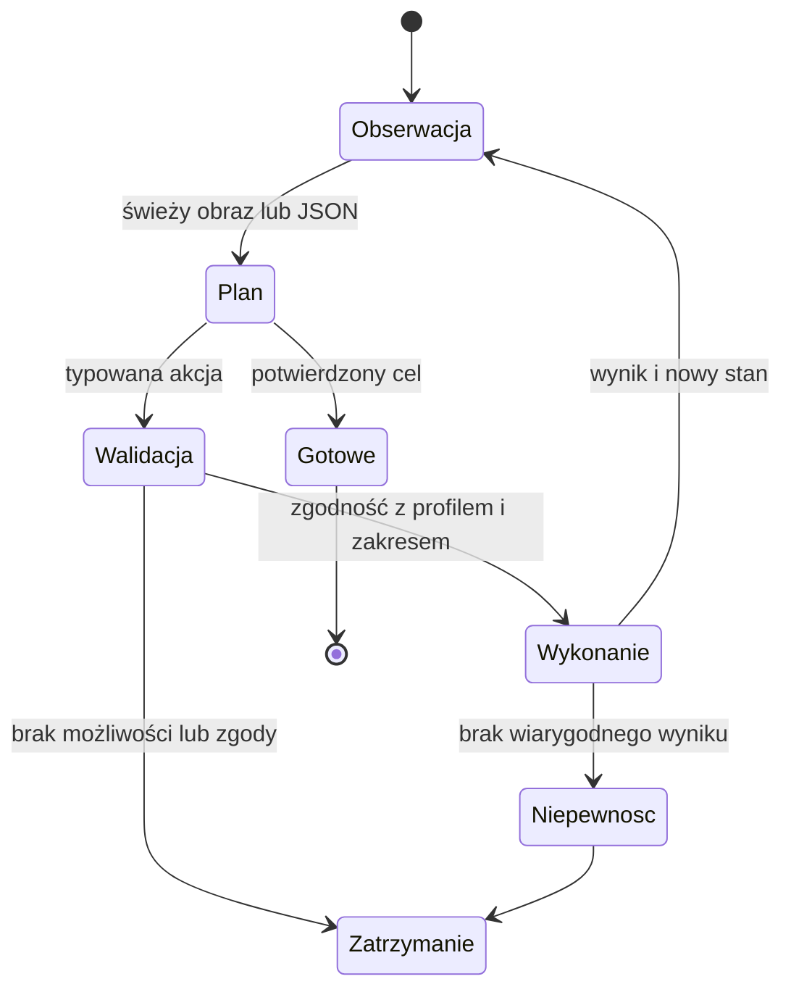

---
{
  "schema": "wellmanifest.docs/document/v1", "id": "clikvm-universal-system",
  "kind": "information", "version": 1, "title": "System hey Asa dla wielu urządzeń",
  "status": "draft", "owner": "clikVM/m5stack", "scope": "repository",
  "created": "2026-11-21", "updated": "2026-11-21", "review_after": "2026-12-21",
  "evidence": ["../gateway/docs/compatibility.json", "validation.md"]
}
---

# Jeden agent, różne kanały dostępu

Wersja 0.2 rozszerza działający kontrakt Androida na komputery, RFB/VNC i HTTP API.
Nie zakłada, że każde urządzenie ma ADB ani że samo podłączenie klawiatury daje
obraz. Uniwersalność wynika z adapterów oraz deklaracji ich możliwości.

## Wybór rozwiązania

| Cel | Obserwacja | Wykonawca | M5Stack | Wymaganie pierwszego uruchomienia |
|---|---|---|---|---|
| Android, bez aplikacji z Google Play | PNG przez ADB | USB host AOA/ADB | Profil bazowy | Właściciel włącza debugowanie i zatwierdza RSA; kwalifikacja USB/VBUS |
| Windows | Screenshot sesji użytkownika | Native Python | Profil network | Instalacja agenta i dostęp do normalnego pulpitu |
| macOS | Screenshot sesji użytkownika | Native Python | Profil network | Uprawnienia Screen Recording i Accessibility |
| Linux X11 | Screenshot sesji X11 | Native Python | Profil network | Agent w właściwej sesji z DISPLAY/Xauthority |
| VM / istniejący VNC | Framebuffer RFB | Bridge RFB | Profil network | Zgodny serwer, autoryzacja, TLS lub zaufany tunel |
| Urządzenie / usługa HTTP | Stan JSON | Bridge HTTP API | Profil network | Stały origin, odczyt stanu i dozwolone operacje |
| Samo wejście USB | Brak | TinyUSB HID device | Profil hid | Rola PC-host, bus-powered lub kwalifikowane monitorowanie VBUS |
| Android tylko AOA | Brak | AOA HID host | Profil bazowy | Obsługa AOA HID przez telefon |
| Wayland | Zależnie od serwera RFB | RFB albo przyszły portal | Profil network | Portal native nie jest zaimplementowany |
| iOS/iPadOS | Brak ogólnego kanału w tym wydaniu | Ewentualnie API konkretnej usługi | Profil network | Brak ADB i brak implementacji pełnego iOS KVM |
| BIOS / instalator / urządzenie bez agenta | Wymagane niezależne wideo | Przyszły adapter sprzętowego KVM | HID może dostarczyć KM | Osobny capture/HDMI oraz integracja, której nie zawiera 0.2 |

Lista [compatibility.json](../gateway/docs/compatibility.json) oddziela implementację
od kwalifikacji fizycznej. Nie traktuj nazwy platformy jako potwierdzenia każdego
wydania OS, kompozytora, telefonu czy aplikacji. Wszystkie testy HIL są NOT_RUN.

## Role w systemie

**Gateway** utrzymuje sesję, model możliwości, cel, kolejkę akcji, dzierżawy,
obserwacje i audyt. Operator konfiguruje model/OQLLM, STT i TTS. Klucze tych
usług pozostają na serwerze. SQLite wymaga pojedynczego procesu właściciela.

**Wykonawca urządzenia** rejestruje profil i dostarcza aktualną obserwację.
Może być firmware Androida albo `clikvm-node` z backendem native, RFB lub API.
Odbiera jedną akcję, sprawdza jej zakres, wykonuje ją, zgłasza wynik i odczytuje
stan ponownie. Nie otrzymuje tekstu dowolnego polecenia powłoki.

**Kontroler głosowy** zbiera audio i wysyła polecenia do przypisanego wykonawcy.
Jego tożsamość i token są odrębne od urządzenia docelowego i operatora.
W 0.2 przypisanie jest statyczne po stronie gatewaya. Automatyczne wyszukiwanie
urządzeń i swobodne przełączanie celów głosem nie są zaimplementowaną funkcją.

**Operator** widzi aktualny obraz albo JSON, stan zadania i błąd/niepewność.
Może zatrzymać dalsze kroki i rozstrzygnąć sytuację na podstawie nowej obserwacji.
Ważne jest rozróżnienie prywatnego panelu gatewaya od informacyjnej strony SET.

## Pętla autonomicznego zadania

Osiem typów akcji to `tap`, `swipe`, `key`, `text`, `open_url`, `screenshot`,
`wait` i `api`. Profil nie musi obsługiwać wszystkich. `key` ma deklarowaną
listę klawiszy i semantykę systemu. `api` oznacza wyłącznie lokalnie skonfigurowaną
operację z zamkniętym schematem argumentów; model nie wybiera hosta ani nagłówka
Authorization. `text` w tej wersji zachowuje wspólny zakres drukowalnego ASCII
bez `%`; cel po polsku oraz STT pozostają UTF-8.

Gateway kontroluje sesję, generację połączenia, numer i świeżość obserwacji,
termin ważności akcji oraz dzierżawę wykonania. `clikvm-node` zapisuje trwały
dziennik akcji przed wykonaniem. Utrata odpowiedzi HTTP nie powoduje ponownego
kliknięcia. Po restarcie albo wyniku `uncertain` system wymaga odczytu stanu
i rozstrzygnięcia, zamiast odtwarzać nierozliczone mutacje.

Wymóg świeżości jest celowy: urządzenie udostępniające samo KM nie otrzymuje
autonomicznego planu. Capture żąda rzeczywistej obserwacji od wykonawcy; nie
powstaje fikcyjny obraz udający ekran. Przykłady symulatora są jawnie oznaczone.

## Trzy osobowości firmware

Każda z płyt CoreS3 K128, Waveshare LCD1.54 SKU 33867 i Touch33869 ma osobny
profil dla każdego trybu. Szczegóły elektryczne i pełna tabela są w
[controller-modes.md](controller-modes.md).

| Sufiks profilu | Rola USB | Tożsamość w gatewayu | Co robi |
|---|---|---|---|
| Brak, np. `cores3` | Host | Token urządzenia | Android AOA HID, ADB, PNG, wykonywanie akcji |
| `-network` | USB OTG nie obsługuje celu | Token kontrolera | Głos, capture, cancel, opcjonalny TTS przypisanego celu |
| `-hid` | Device | Token kontrolera dla funkcji sieciowych | Ręczny KM przez USB i oddzielny kontroler sieciowy |

ESP32-S3 ma jeden wewnętrzny tor USB OTG. Nie udaje jednocześnie hosta ADB
i urządzenia HID na tym samym złączu. Wybór osobowości wymaga odpowiedniego
builda/flashowania. AOA HID w profilu Androida jest protokołem akcesorium
wysyłanym przez hosta, nie zwykłym USB keyboard device.

Profil HID nie routuje automatycznie akcji modelu do TinyUSB na podstawie obrazu
z agenta PC. W 0.2 manualny KM i sieciowa pętla zadania są odrębne. Hybryda wymaga
powiązania dwóch transportów z jednym celem, układem współrzędnych, generacją
i obserwacją; nie wolno jej uzyskać przez usunięcie tych kontroli.

## Najkrótsza droga do działającego pokazu

1. **Posiadany komputer + CoreS3 network.** Uruchom gateway i native node na
   własnej sesji PC. Sprawdź `doctor`, potem jeden prosty cel w panelu. Dopiero
   potem dodaj głos i wybrany STT/TTS. Nie wymaga to zakupu toru USB hosta Androida.
2. **Jeden Android.** Zapisz model i build Androida, dobierz kabel/dok/VBUS,
   sprawdź AOA, świadomą zgodę RSA, screenshot i pojedynczy krok. Potem cały cel
   oraz odłączenie w trakcie akcji. Nie przenoś wyniku na wszystkie telefony.
3. **Jeden serwer RFB.** Użyj prywatnego serwera VM lub laboratorium. Sprawdź
   negocjację, zakres obrazu, zmianę rozdzielczości i brak powtórki przy zerwaniu
   połączenia. Sam port VNC na routerze nie jest rozwiązaniem ochrony transportu.
4. **Jedna operacja API.** Zdefiniuj odczyt stanu i odwracalną zmianę. Argumenty
   wymagają schematu; wynik potwierdza ponowny odczyt JSON. Dodawaj operacje po
   jednej, z testem efektu i błędnej odpowiedzi usługi.
5. **Próba demonstracyjna.** Zaplanuj konkretny scenariusz, limit kroków i sposób
   zatrzymania. Zmierz osobno audio, STT, obraz, plan, wykonanie i weryfikację.
   Nie obiecuj opóźnienia przed pomiarem całego zestawu.

Najniższy koszt kolejnego etapu daje wykorzystanie posiadanego CoreS3 oraz
komputera. Źródła same w sobie nie wymagają nowej płytki. Koszt usług modelowych
i istniejącej infrastruktury zależy od własnego wdrożenia; nie przyjmujemy
niezweryfikowanych cen zakupowych. Tańsza płytka powinna zastąpić CoreS3 dopiero
po kwalifikacji konkretnego profilu audio, USB i zasilania.

## Plan rozszerzenia po 0.2

Poniższa lista opisuje przyszłe prace, nie obecne możliwości.

| Etap | Konkretne rozszerzenie | Kryterium ukończenia |
|---|---|---|
| Kwalifikacja | Macierz Android OEM, Win/macOS/X11 i trzech płyt | Raporty HIL z wersjami, SHA firmware i dowodami |
| Wygodne instalowanie | Podpisane paczki PC, autostart użytkownika, aktualizacja i odinstalowanie | Czysta instalacja i rollback na każdym wspieranym OS |
| Tekst | Unicode przez uzgodniony natywny adapter / schowek | Polskie znaki bez zmiany układu i bez utraty schowka |
| Wayland | Portal RemoteDesktop/ScreenCast i PipeWire | Świadoma zgoda, praca po zmianie monitora i wygaśnięciu sesji |
| Hybrydowy KVM | Obraz z agenta lub capture + wejście M5 HID | Jednoznaczna tożsamość celu, geometria i lease obu kanałów |
| Sprzęt bez systemu | Adapter istniejącego sprzętowego KVM i capture HDMI | Obraz BIOS, hotplug, EDID, brak podwójnego VBUS |
| Flota | Zarządzanie grantami, urządzeniami i podpisane aktualizacje | Zweryfikowany Wellman authority, rollback i odwołanie dostępu |

BLE może być dodatkowym transportem wejścia. Nie dostarczy obrazu ekranu tylko
przez obecność klawiatury/myszy. Kamera pozostaje możliwym przyszłym kanałem
obserwacji optycznej, z osobnym mocowaniem, kalibracją geometrii i detekcją
zasłonięcia; nie jest zaimplementowanym obejściem braku dostępu do ekranu.

## Dokumentacja i źródła

- [Kontrakt wielourządzeniowy gatewaya](../gateway/docs/UNIVERSAL.md).
- [Kontrolery sieciowe i tokeny](../gateway/docs/CONTROLLERS.md).
- [Agent desktopowy](desktop-agent.md), [RFB/API](network-kvm.md).
- [Wyniki walidacji](validation.md), [procedura sprzętowa](hardware-validation.md).
- [Standardy i jawne luki Wellmana](standards.md).
- Podstawy Androida: [AOA 2.0](https://source.android.com/docs/core/interaction/accessories/aoa2),
  [ADB](https://developer.android.com/tools/adb).
- Podstawy RFB: [RFC 6143](https://www.rfc-editor.org/rfc/rfc6143).
- Uprawnienia macOS: [Screen Recording](https://support.apple.com/guide/mac-help/control-access-to-screen-and-system-audio-recording-mchld6aa7d23/mac).
- Przyszły portal: [xdg-desktop-portal RemoteDesktop](https://flatpak.github.io/xdg-desktop-portal/docs/doc-org.freedesktop.portal.RemoteDesktop.html).
